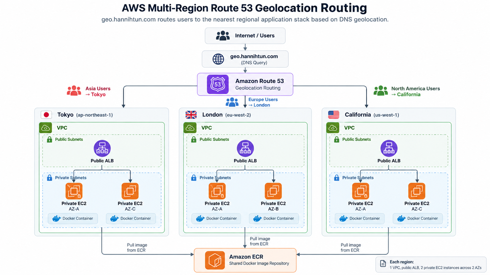
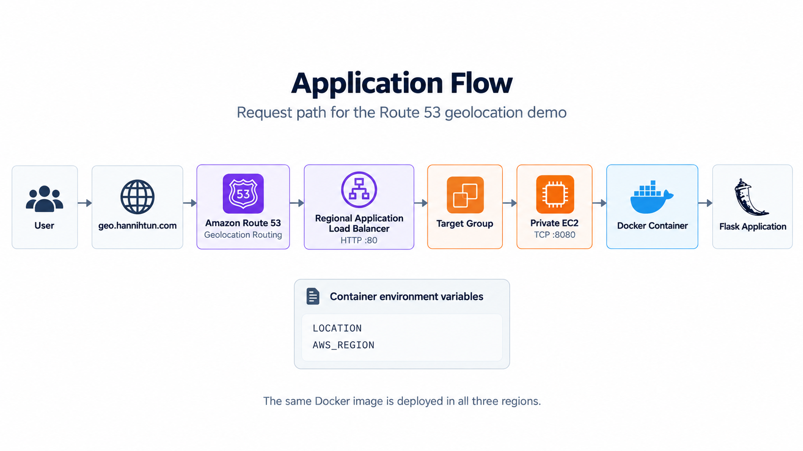
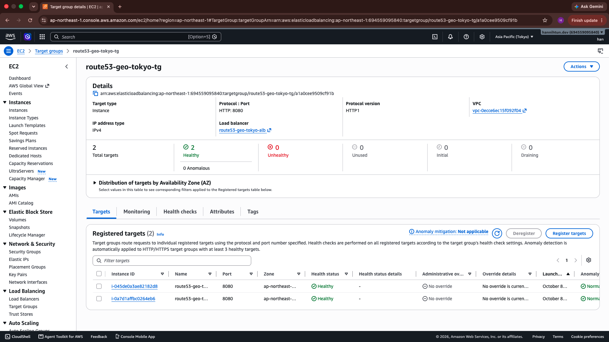
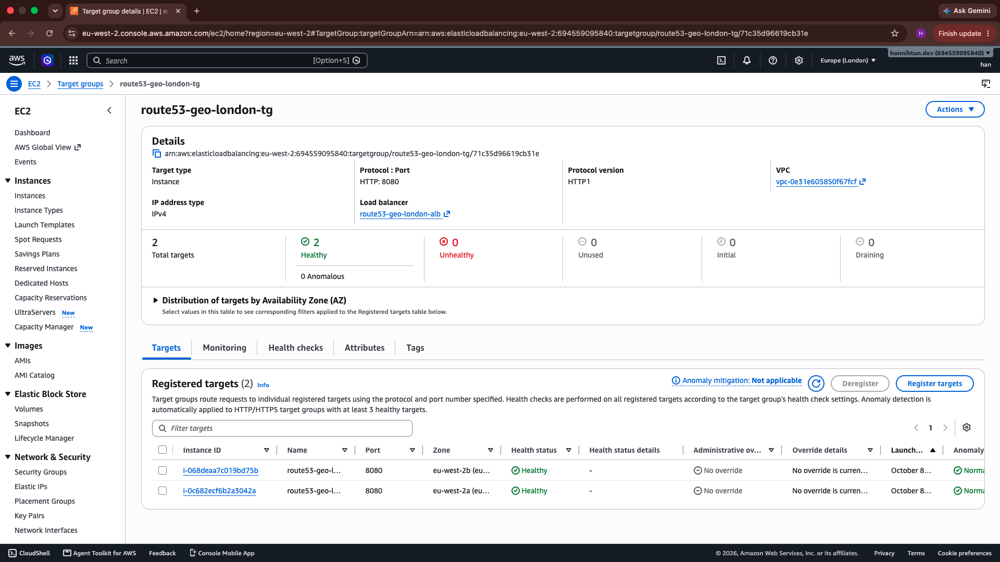
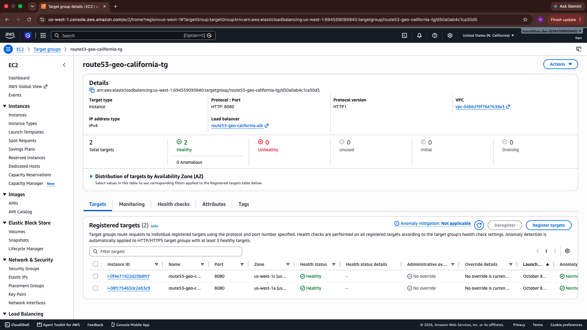
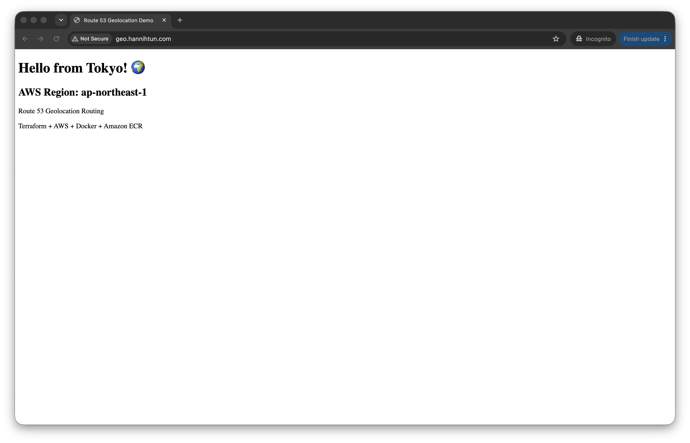
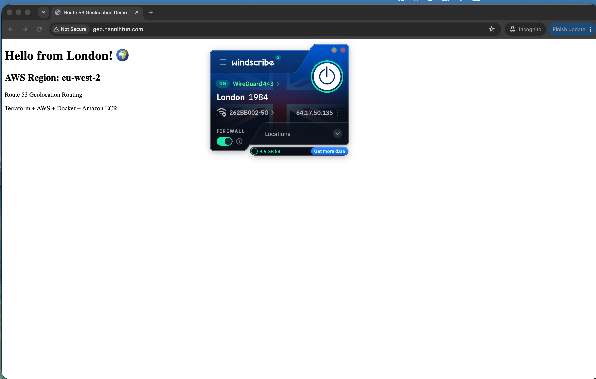
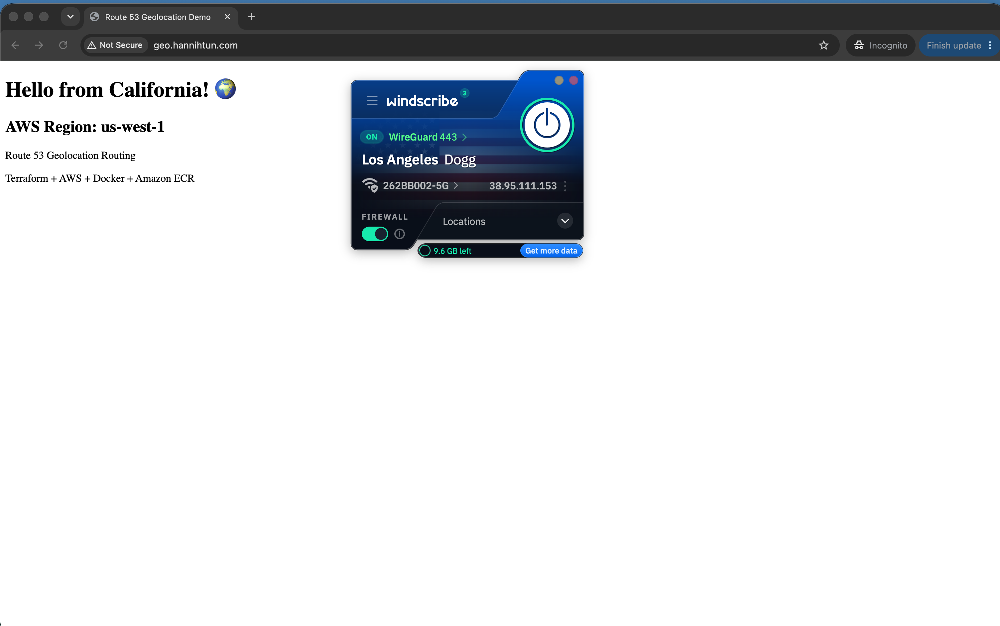

# AWS Multi-Region Route 53 Geolocation Routing

A multi-region AWS architecture built with Terraform that routes users to different AWS regions based on their geographic location using Amazon Route 53 Geolocation Routing.

The application runs in three AWS regions:

- 🇯🇵 Tokyo — `ap-northeast-1`
- 🇬🇧 London — `eu-west-2`
- 🇺🇸 California — `us-west-1`

Users access the application through:

```text
http://geo.hannihtun.com
```

Route 53 determines the geographic location of the DNS request and directs traffic to the appropriate regional Application Load Balancer.

---

## Architecture Overview



The architecture uses Amazon Route 53 geolocation routing to direct users to regional application stacks based on the geographic location of the DNS request.

Each regional environment contains:

- One VPC
- Two public subnets
- Two private subnets
- Internet Gateway
- NAT Gateway
- Public Application Load Balancer
- Two private EC2 instances across two Availability Zones
- Dockerized application
- Target Group and health checks
- Security Groups
- IAM role and instance profile
- AWS Systems Manager access

A shared Docker image is stored in Amazon ECR and pulled by the EC2 instances in all three regions.

---

## Route 53 Geolocation Routing

| Geographic location | Destination | AWS Region |
|---|---|---|
| Asia | Tokyo | `ap-northeast-1` |
| Europe | London | `eu-west-2` |
| North America | California | `us-west-1` |
| Default | Tokyo | `ap-northeast-1` |

The DNS record used for testing is:

```text
geo.hannihtun.com
```

---

## Technologies Used

- AWS
- Terraform
- Amazon Route 53
- Amazon VPC
- Application Load Balancer
- Amazon EC2
- Amazon ECR
- AWS Systems Manager
- IAM
- Docker
- Flask
- Git / GitHub

---

## Application Flow



The same Docker image is deployed in all three regions.

Region-specific information is passed to the container using environment variables:

```text
LOCATION
AWS_REGION
```

This allows the application to display which AWS region served the request.

---

## Container Image

The application is packaged as a Docker image and stored in Amazon ECR.

The ECR repository is hosted in the Tokyo region and is used by EC2 instances in all three regions.

Each EC2 instance authenticates to ECR, pulls the application image, and starts the container during instance initialization.

The application listens on:

```text
8080
```

---

## Security Design

### Private EC2 Instances

Application EC2 instances are deployed only in private subnets and do not receive public IPv4 addresses.

### No SSH Exposure

Port `22` is not exposed.

Administrative access is performed using:

```text
AWS Systems Manager Session Manager
```

### Security Group Flow

```text
Internet
   │
   │ HTTP :80
   ▼
ALB Security Group
   │
   │ TCP :8080
   ▼
EC2 Security Group
```

The EC2 security group accepts application traffic only from the corresponding ALB security group.

---

## Multi-AZ Design

Each region runs two EC2 instances across two Availability Zones.

This provides redundancy at the application layer and allows each regional Application Load Balancer to distribute traffic between multiple healthy targets.

---

## Target Health

### Tokyo



### London



### California



All three target groups were verified with:

```text
2 Healthy
0 Unhealthy
```

---

## Geolocation Routing Test

### Asia → Tokyo

Testing from Japan returned the Tokyo deployment:



Expected result:

```text
Hello from Tokyo!
AWS Region: ap-northeast-1
```

---

### Europe → London

A VPN endpoint in London was used to simulate a European user.



Expected result:

```text
Hello from London!
AWS Region: eu-west-2
```

---

### North America → California

A VPN endpoint in Los Angeles was used to simulate a North American user.



Expected result:

```text
Hello from California!
AWS Region: us-west-1
```

---

## Deployment

Initialize Terraform:

```bash
terraform init
```

Validate the configuration:

```bash
terraform fmt
terraform validate
```

Review the execution plan:

```bash
terraform plan
```

Apply the infrastructure:

```bash
terraform apply
```

> The application Docker image must be available in Amazon ECR for the EC2 instances to pull and start the application successfully.

---

## Design Decisions

### One NAT Gateway per Region

This project uses one NAT Gateway per region instead of one NAT Gateway per Availability Zone.

This reduces lab cost while keeping EC2 instances private.

For a production architecture requiring stronger Availability Zone independence, a NAT Gateway per AZ would normally be considered.

### Central ECR Repository

A single ECR repository in Tokyo is shared by all regions.

This simplifies the lab architecture but introduces a cross-region dependency.

For production, ECR cross-region replication or separate regional repositories could be used.

### EC2 Instead of Auto Scaling Groups

Two EC2 instances are explicitly deployed in each region to demonstrate multi-AZ application availability.

A production architecture could use Auto Scaling Groups for automatic scaling and instance replacement.

---

## Cost Considerations

The architecture contains resources that can generate ongoing AWS charges, especially:

- NAT Gateways
- Application Load Balancers
- EC2 instances
- Public IPv4 addresses
- Route 53 hosted zone and DNS queries
- Cross-region data transfer

Lab resources should be destroyed when they are no longer required.

---

## Current Limitations

The current implementation uses HTTP.

```text
http://geo.hannihtun.com
```

HTTPS is not implemented in the current version and is planned as a future enhancement.

---

## Possible Future Improvements

- HTTPS using AWS Certificate Manager
- HTTP → HTTPS redirect
- Auto Scaling Groups
- Launch Templates
- ECR cross-region replication
- NAT Gateway per Availability Zone
- Remote Terraform state using S3
- Terraform state locking
- CI/CD pipeline
- Automated Docker image build and deployment
- Monitoring with CloudWatch
- AWS WAF
- More advanced application health checks

---

## What I Learned

This project provided hands-on experience with:

- Designing multi-region AWS infrastructure
- Route 53 geolocation routing
- Multi-AZ application architecture
- Terraform provider aliases
- Private subnet architecture
- Application Load Balancers
- Docker image deployment with Amazon ECR
- IAM roles for EC2
- AWS Systems Manager Session Manager
- Security group referencing
- Terraform resource dependencies
- DNS delegation and testing
- Testing geographic routing using VPN endpoints

---

## Cleanup

Because resources such as NAT Gateways and Application Load Balancers generate ongoing charges, destroy lab resources after testing.

Before destroying infrastructure, review the plan carefully:

```bash
terraform plan -destroy
```

Then:

```bash
terraform destroy
```

The ECR repository in this project uses Terraform lifecycle protection to help prevent accidental deletion of the application image.

---

## Project Status

✅ Terraform infrastructure deployed successfully  
✅ Tokyo deployment verified  
✅ London deployment verified  
✅ California deployment verified  
✅ All regional target groups healthy  
✅ Route 53 geolocation routing verified